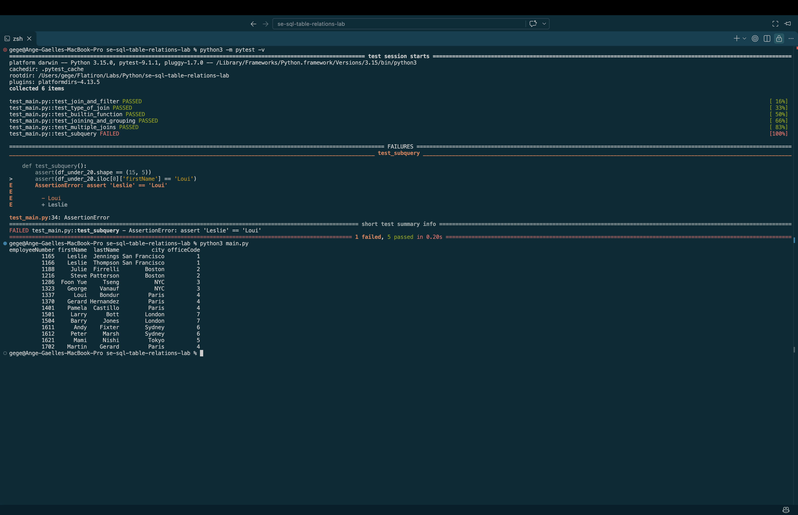

# SQL Lab: Table Relations

## Overview

This lab focuses on writing SQL queries to retrieve, combine, and analyze data across multiple tables in a relational database.

Using Python, Pandas, and SQLite, I practiced working with the Northwind CRM database to explore relationships between employees, offices, customers, orders, products, and payments.

The lab emphasizes SQL joins, aggregate functions, grouping, and subqueries to answer business-related questions.

## Technologies Used

- Python 3
- SQLite3
- Pandas
- Pytest
- Git and GitHub

## Project Structure

```text
se-sql-table-relations-lab/
├── main.py
├── test_main.py
├── data.sqlite
├── Pipfile
├── Pipfile.lock
└── README.md
```

## Lab Sections

### Part 1: Join and Filter

Practiced combining data from related tables using SQL joins.

- Retrieved employees working in the Boston office.
- Identified offices with no assigned employees.
- Used `JOIN` and `LEFT JOIN` to connect employee and office records.
- Applied `WHERE` conditions to filter results.

### Part 2: Types of Joins

Explored different SQL joins and how they affect returned records.

- Retrieved employees and their office locations.
- Identified customers who had never placed an order.
- Used `LEFT JOIN` to preserve records without matching entries.
- Used `IS NULL` to identify unmatched records.

### Part 3: Built-In Functions

Practiced using SQL functions to process and sort data.

- Retrieved customer payment information.
- Used `CAST()` to convert values into numeric data types.
- Sorted payments by amount using `ORDER BY`.

### Part 4: Joining and Grouping

Combined joins with aggregate functions to analyze business data.

- Identified employees whose customers had an average credit limit greater than $90,000.
- Counted customers assigned to qualifying employees.
- Calculated product order counts and total units sold.
- Used `GROUP BY` and `HAVING` to organize and filter aggregated results.

### Part 5: Multiple Joins

Practiced joining several related tables in a single query.

- Calculated the number of unique customers purchasing each product.
- Counted customers associated with each office.
- Connected products, order details, orders, and customers.
- Used `COUNT(DISTINCT ...)` to avoid counting duplicate customers.

### Part 6: Subqueries

Practiced using nested SQL queries to filter data based on calculated results.

- Identified products purchased by fewer than 20 distinct customers.
- Retrieved employees associated with sales of those products.
- Used a subquery with `GROUP BY` and `HAVING`.
- Used `DISTINCT` to prevent duplicate employee records.

## SQL Concepts Practiced

| SQL Keyword | Purpose |
|-------------|---------|
| SELECT | Retrieves data from a table |
| FROM | Specifies the table to query |
| WHERE | Filters rows based on conditions |
| INNER JOIN | Combines matching records from related tables |
| LEFT JOIN | Preserves all records from the left table |
| ON | Defines the relationship between joined tables |
| IS NULL | Identifies missing or unmatched values |
| CAST() | Converts values between data types |
| ORDER BY | Sorts query results |
| ASC | Sorts in ascending order |
| DESC | Sorts in descending order |
| COUNT() | Counts records |
| SUM() | Calculates a total |
| AVG() | Calculates an average |
| DISTINCT | Removes duplicate values |
| GROUP BY | Groups records by shared values |
| HAVING | Filters grouped results |
| IN | Checks whether a value matches a set of values |
| Subquery | Uses a nested query within another SQL query |

## Installation and Setup

### 1. Clone the Repository

```bash
git clone git@github.com:a-gbatie/se-sql-table-relations-lab.git
cd se-sql-table-relations-lab
```

### 2. Install Dependencies

```bash
python3 -m pip install pandas pytest
```

### 3. Run the Program

```bash
python3 main.py
```

## Testing

Run all tests with:

```bash
python3 -m pytest -v
```

## Screenshot of Completed Tests


